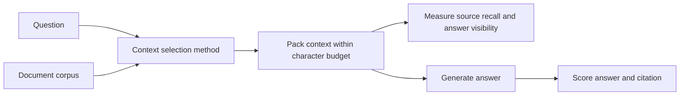

# Context Selection Experiment

## Research question

How do different context selection methods affect evidence coverage, prompt size, and answer quality?

The experiment compares five ways to prepare source documents before a language model answers a question. All service names, policies, and values in the benchmark are fictional.

## Experiment flow

Each method receives the same question, document corpus, top-three setting, and character budget. The packer adds complete source blocks in ranking order. It skips a block that does not fit and continues to later candidates. It does not cut documents in half or retrieve replacement candidates.

The budget counts source labels, titles, document text, and separators. It excludes system instructions and the question. It measures characters, not model tokens.

## Benchmark data

The corpus contains 38 fictional policy documents for nine services. Each service has current billing, access, backup, and deployment policies. Two services also have archived billing documents with obsolete values.

The question set contains 50 labeled cases:

| Question type | Count | Purpose |
| --- | ---: | --- |
| Direct | 36 | Ask for a fact using wording close to its source. |
| Paraphrase | 9 | Ask for a fact with different wording. |
| Unanswerable | 5 | Ask for a fact that does not appear in the corpus. |

Each answerable question has one gold evidence document. Unanswerable cases expect the model to abstain with `NOT_FOUND` and no citation.

## Methods

| Method | Selection process | Trade-off |
| --- | --- | --- |
| `full` | Consider all documents in fixed corpus order. | Simple baseline; earlier documents can use the budget before relevant evidence appears. |
| `bm25` | Rank full document text by weighted query-word matches; take the highest-scoring candidates. | Fast and interpretable; exact word overlap matters. |
| `dense` | Embed the question and each whole document; rank by cosine similarity. | Can match related wording; embedding setup adds cost and semantic similarity can select the wrong evidence. |
| `dense_compressed` | Use dense retrieval, then retain up to two sentences per selected document based on query-word overlap. | Smaller context; compression can remove the sentence with the answer. |
| `jit` | Search document titles and summaries, then load the full text of the top matches. | Uses metadata for initial search; fixed retrieval, not autonomous model tool use. |

### How dense retrieval works

An embedding model maps each document and question to a numeric vector. Cosine similarity compares the direction of the question vector with each document vector. The method ranks the documents by this score and selects the top candidates. The score is a ranking signal, not a probability that a document contains the answer.

### How BM25 works

BM25 gives more weight to query words that appear in fewer documents. It also accounts for how often a word appears in one document and normalizes for document length. The method sorts documents by score and uses document ID to break ties. It does not expand synonyms or stem words.

## Procedure

1. Use the same corpus and labeled questions for each method.
2. Select up to three candidates per question, except `full`, which considers the corpus in order.
3. Pack complete source blocks under a 3,000-character budget.
4. Measure whether each gold source and expected answer remain in the packed context.
5. In the generation experiment, send the packed context and question to a language model.
6. Score the generated answer and its citation against the labels.
7. Repeat selected retrieval methods at a 6,000-character budget to observe budget sensitivity.

The saved generation experiment covers all 50 questions. The saved 6,000-character comparison covers `full`, `bm25`, and `jit` only.

## Measures

| Measure | Definition |
| --- | --- |
| Gold-document recall | Fraction of required source IDs present in packed context. Not applicable to unanswerable questions. |
| Answer visibility | Whether the normalized expected answer text appears in packed context. This measures evidence preservation, not model correctness. |
| Context characters | Number of characters in packed source blocks. |
| Input tokens | Tokens reported by the generation model for its prompt. Available only in generation runs. |
| Answer accuracy | Whether the generated answer contains the expected answer. `NOT_FOUND` must match exactly. |
| Citation accuracy | Whether the cited source is gold, or the citation is empty for an unanswerable question. |
| Latency | Time for selection and packing; generation runs also record total observed time. Hardware, model state, and caching affect timing. |

Answer and citation accuracy are scored separately. The evaluator uses normalized string matching. It does not assess semantic equivalence or verify that a citation fully supports a claim.

## Results

### Retrieval: 50 questions, 3,000-character budget

| Method | Gold-document recall | Answer visible | Mean context characters |
| --- | ---: | ---: | ---: |
| `full` | 0.111 | 0.111 | 2,936 |
| `bm25` | 0.978 | 0.978 | 1,902 |
| `dense` | 1.000 | 1.000 | 1,887 |
| `dense_compressed` | 1.000 | 0.756 | 693 |
| `jit` | 0.889 | 0.889 | 1,848 |

Recall and visibility exclude the five unanswerable questions. Dense retrieval found every gold document in this benchmark. Compression reduced average context size by about 63% compared with dense retrieval, but the expected answer remained visible in only 75.6% of answerable cases. It removed answer text in 11 of 45 cases.

### Generation: 50 questions, 3,000-character budget

| Method | Answer accuracy | Citation accuracy | Mean input tokens |
| --- | ---: | ---: | ---: |
| `full` | 0.20 | 0.20 | 764.94 |
| `bm25` | 0.82 | 0.94 | 541.06 |
| `dense` | 0.90 | 1.00 | 538.86 |
| `dense_compressed` | 0.66 | 0.70 | 327.00 |
| `jit` | 0.76 | 0.88 | 533.58 |

In this saved run, dense retrieval had the highest answer and citation scores. Compression used fewer input tokens, but its answer and citation scores were lower. These are results for this model run and synthetic benchmark, not general performance guarantees.

### Budget sensitivity: 6,000 characters

The saved comparison contains three methods. `full` recall increases from 0.111 at 3,000 characters to 0.222 at 6,000. `bm25` and `jit` scores remain unchanged. No 6,000-character dense comparison is available.

## Interpretation and limits

- The synthetic corpus uses repeated templates. It does not represent the variety of real operational documents.
- Each answerable question has one gold document. The experiment does not test multi-document reasoning.
- Character budgets only approximate token budgets. Token counts depend on the model tokenizer.
- Exact-string scoring can miss correct alternative wording or accept answers with extra text.
- Dense retrieval compares every document vector. This benchmark does not test large-scale indexing.
- `jit` uses a fixed search-and-load routine. It does not test autonomous agents or tool use.
- Saved measurements do not record model versions or hardware. Treat latency and answer scores as observations from specific runs.

To test performance on real material, repeat the experiment with a separate corpus and human-labeled questions. Keep evaluation questions separate from questions used to tune the methods.
